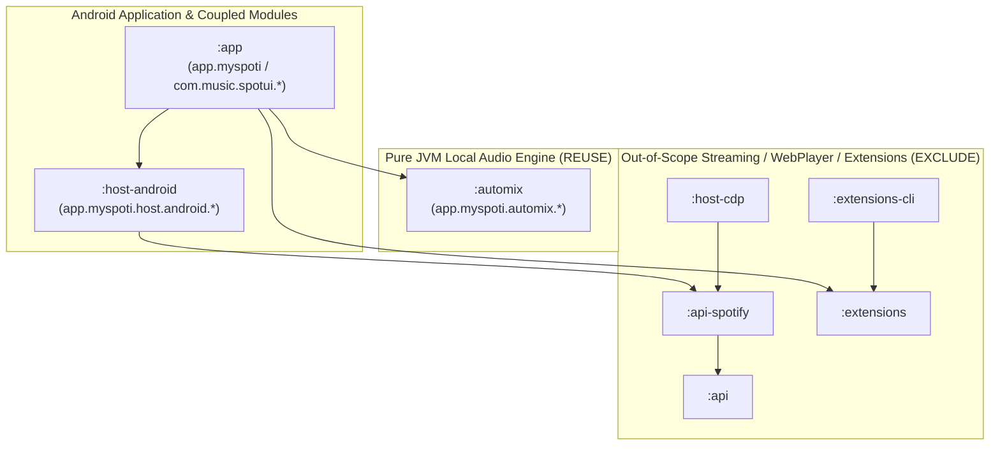

# Stage 00 — Repository Baseline Intake, Dependency Audit & License/Threat Register

- **Date (UTC):** 2026-11-12
- **Stage:** 00 (`STAGES/00_REPO_INTAKE.txt`)
- **Working Project Name:** SetFlow (placeholder; final legally distinct name to be confirmed before distribution)
- **Upstream Source:** `https://github.com/kota-zo/myspoti`
- **Pinned Upstream Commit SHA:** `95a24e7e4de82ec89d4ec11d5b05b146c44d78e7`
- **Upstream Release Tag:** `v2.4.0` (`2026-11-05 20:50:03 +0100`, `"2.4.0 release notes, version fallback 2.4.0"`)
- **Working Branch:** `audit/stage-00-intake` (push to `upstream` explicitly disabled via `git remote set-url --push upstream DISABLED`)

---

## 1. Toolchain, SDK & Dependency Pin Inventory

Verified from `base/settings.gradle.kts`, `base/gradle/wrapper/gradle-wrapper.properties`, `base/gradle/libs.versions.toml`, `base/app/build.gradle.kts`, and `base/automix/build.gradle.kts`:

| Component | Pinned Version / Value | Source File | Status / Notes |
|---|---|---|---|
| **Gradle Wrapper** | `9.8.2` (`gradle-9.8.2-bin.zip`) | `base/gradle/wrapper/gradle-wrapper.properties` | Wrapper JAR SHA-256: `3b8a25775a69158b5ad2b1d17a80a88dc7b40a352a73eb27d06c612a7ce68e98` |
| **Android Gradle Plugin (AGP)** | `9.4.1` | `base/gradle/libs.versions.toml` | Applied to `:app` and `:host-android` |
| **Kotlin** | `2.4.21` | `base/gradle/libs.versions.toml` | `kotlin-jvm`, `kotlin-compose`, `kotlin-serialization` |
| **Java / JVM Target** | Java `17` (`JavaVersion.VERSION_17` / `jvmToolchain(17)`) | `base/app/build.gradle.kts`, `base/automix/build.gradle.kts` | Host environment runs OpenJDK `21.0.12.1` (supports toolchain 17) |
| **Android `compileSdk`** | `37` | `base/app/build.gradle.kts`, `base/host-android/build.gradle.kts` | Local `/root/android-sdk/platforms` currently has `android-35`, `android-36`, `android-36.1` (`android-37` must be installed or resolved in Stage 01) |
| **Android `minSdk`** | `29` (Android 10) | `base/app/build.gradle.kts` | Matches target V1 baseline (`minSdk 29`) |
| **Android `targetSdk`** | `36` | `base/app/build.gradle.kts` | Scoped storage and Android 14–16 foreground service rules apply |
| **AndroidX Media3** | `1.8.0` | `base/app/build.gradle.kts` | `media3-exoplayer`, `media3-exoplayer-dash`, `media3-ui`, `media3-datasource`, `media3-database` (`@UnstableApi` used in `SegueProcessor`/`LocalPlayer`/`TrackDecoder`) |
| **AndroidX Legacy Media** | `1.8.0` | `base/gradle/libs.versions.toml` | `androidx.media:media:1.8.0` used by `:host-android` `PlaybackService` (`MediaBrowserServiceCompat`) |
| **ONNX Runtime** | `1.23.2` | `base/automix/build.gradle.kts`, `base/app/build.gradle.kts` | `com.microsoft.onnxruntime:onnxruntime:1.23.2` (JVM `compileOnly`/`testImplementation`) and `onnxruntime-android:1.23.2` in `:app` |
| **Beat This! ONNX Model** | `small0` int8 (`beat-this-small0-int8.onnx`) | `base/app/src/main/assets/automix/beat-this-small0-int8.onnx` | SHA-256: `bdb1c529363498e7798ea25e117e6550d1b83884c1c99c41ba9cd0657ceaebd4` (MIT license, CPJKU) |
| **Compose BOM** | `2026.06.01` (`material3 = 1.5.0-beta02`) | `base/gradle/libs.versions.toml` | Beta Material3 artifact |
| **Coroutines / Serialization** | `1.11.0` / `1.11.0` | `base/gradle/libs.versions.toml` | `kotlinx-coroutines-*`, `kotlinx-serialization-json` |
| **Reorderable** | `3.1.0` | `base/app/build.gradle.kts` | `sh.calvin.reorderable:reorderable:3.1.0` (Apache-2.0) |
| **Test Frameworks** | JUnit `4.13.2`, JUnit Jupiter `5.13.4`, Robolectric `4.14.1`, Roborazzi `1.40.1` | `base/app/build.gradle.kts`, `base/automix/build.gradle.kts` | `:automix` uses JUnit 4 + desktop bench `JavaExec` task |

---

## 2. Actual Module & Source Dependency Graph

### 2.1 Gradle Modules in `base/settings.gradle.kts`

### 2.2 Detailed Class-Level Dependency Map (Real Source Paths & Imports)

1. **`:automix` (`base/automix/src/main/kotlin/app/myspoti/automix/`) — Zero Android or Spotify dependencies:**
   - `Analyzer.kt`, `BeatTracker.kt`, `Features.kt`, `Fft.kt`, `MixPlan.kt`, `MixPlanner.kt`, `Sections.kt`, `SungSpans.kt`, `TrackAnalysis.kt`, `VocalRisk.kt`
     - **Imports:** `kotlin.math.*`, `java.io.*`, `java.util.*` only.
   - `BeatThis.kt`
     - **Imports:** `ai.onnxruntime.OnnxTensor`, `ai.onnxruntime.OrtEnvironment`, `ai.onnxruntime.OrtSession`, `java.nio.FloatBuffer`.
   - `segue/SeguePlan.kt`, `segue/SegueFormat.kt`, `segue/SegueValidator.kt`, `segue/SegueCompiler.kt`, `segue/SegueJson.kt`, `segue/SegueDeck.kt`, `segue/SeguePolicy.kt`, `segue/SegueScore.kt`, `segue/SegueStretch.kt`, `segue/SegueTuning.kt`, `segue/SegueGuards.kt`
     - **Imports:** Only `app.myspoti.automix.*`, `kotlin.math.*`, `java.math.BigDecimal`, `java.security.MessageDigest`.
     - **Experimental status note:** `docs/automix/segue-design.md` explicitly states that `SegueTuning.kt` parameters are `[I]` (inferred) or `[R]` (reused) starting values rather than `[M]` (measured on corpus), and `Gesture` (`REPEAT`) is rejected by `SegueDeck.playable()`.

2. **`:app` AutoMix Bridge (`base/app/src/main/java/com/music/spotui/automix/`):**
   - `SegueProcessor.kt` (`com.music.spotui.automix.SegueProcessor`, `com.music.spotui.automix.SegueSink`)
     - **Imports:** `androidx.media3.common.C`, `androidx.media3.common.audio.AudioProcessor`, `androidx.media3.common.audio.BaseAudioProcessor`, `androidx.media3.exoplayer.audio.AudioSink`, `androidx.media3.exoplayer.audio.ForwardingAudioSink`, `app.myspoti.automix.segue.LaneSide`, `app.myspoti.automix.segue.SegueDeck`, `app.myspoti.automix.segue.SeguePlan`.
     - **Coupling:** **Zero coupling** to Spotify, `Graph`, or UI. Pure Media3 <-> `:automix` bridge!
   - `MixPreparation.kt` (`com.music.spotui.automix.MixPreparation`)
     - **Imports:** None (`kotlin.math.abs`). Pure state-readiness helper functions.
   - `DeckEq.kt` (`com.music.spotui.automix.DeckEq`)
     - **Imports:** `android.media.audiofx.DynamicsProcessing`, `app.myspoti.automix.Features`. Calls `AutoMix.journal(...)` on exception.
   - `AnalysisRetry.kt` (`com.music.spotui.automix.AnalysisRetry`)
     - **Imports:** None. Pure backoff helper.
   - `AnalysisIdentity.kt` (`com.music.spotui.automix.AnalysisIdentity`)
     - **Imports:** Pure Kotlin/Java (`java.util.Base64`). `AnalysisIdentity.file(uri, size, modifiedAt)` is local-safe; `AnalysisIdentity.stream(...)` is for extension streams.
   - `TrackDecoder.kt` (`com.music.spotui.automix.TrackDecoder`)
     - **Imports:** `android.media.AudioFormat`, `MediaCodec`, `MediaDataSource`, `MediaExtractor`, `MediaFormat`, `android.net.Uri`, `androidx.media3.common.C`, `androidx.media3.datasource.DataSpec`, **`com.music.spotui.data.offline.OfflineCrypto`**, **`com.music.spotui.data.offline.ExtStreamCache`**, **`com.music.spotui.di.Graph`**.
     - **Coupling:** `ByteSource` instantiates `ExtStreamCache.Factory(Graph.app).createDataSource()`. For local-only use, `TrackDecoder` only needs a standard local `ContentResolver` / `DefaultDataSource.Factory(context)` or `MediaExtractor.setDataSource(context, uri, null)` without `ExtStreamCache` or `OfflineCrypto`.
   - `AutoMix.kt` (`com.music.spotui.automix.AutoMix`)
     - **Imports:** `app.myspoti.automix.*`, **`com.music.spotui.di.Graph`**, **`com.music.spotui.extensions.ExtensionAudio`**, **`com.music.spotui.cast.CastPlayback`**, **`com.music.spotui.di.LocalPlayer`**, **`com.music.spotui.data.DataSaver`**, **`app.myspoti.power.EnergySettings`**, **`app.myspoti.host.android.Logbook`**, **`app.myspoti.host.android.MyspotiRuntime`**.
     - **Coupling:** Moderately coupled to Myspoti singletons (`Graph.app`, `ExtensionAudio`, `CastPlayback`, `MyspotiRuntime.api.ready` in `waitForThePage()`).

3. **`:app` Local Playback & Audio Processors (`base/app/src/main/java/com/music/spotui/di/` and `data/local/`):**
   - `EqualizerProcessor.kt` (`com.music.spotui.di.EqualizerProcessor`, `EqBands`)
     - **Imports:** `androidx.media3.common.C`, `AudioProcessor`, `BaseAudioProcessor`. Reads `com.music.spotui.data.preferences.EqualizerPref` for band gains.
   - `SpatialProcessor.kt` (`com.music.spotui.di.SpatialProcessor`, `Spatial`)
     - **Imports:** `androidx.media3.common.C`, `AudioProcessor`, `BaseAudioProcessor`. Zero Spotify coupling.
   - `CrossfadeRamp.kt`, `LocalQueueOrder.kt`, `LocalRepeat.kt`, `StreamErrors.kt`
     - **Imports:** Pure Kotlin helpers.
   - `LocalMusic.kt` (`com.music.spotui.data.local.LocalTrack`, `LocalMusic`, `LocalFolders`)
     - **Imports:** `android.Manifest`, `ContentUris`, `Context`, `PackageManager`, `Uri`, `Build`, `MediaStore`, `kotlinx.coroutines.*`. Zero Spotify coupling (except `isRadio` flag comment).
   - `LocalPlayer.kt` (`com.music.spotui.di.LocalPlayer`)
     - **Imports & references:** `ExoPlayer`, `LocalTrack`, `CrossfadePref`, `MixPreparation`, `SegueProcessor`, `SegueSink`, `EqualizerProcessor`, `SpatialProcessor`, `DeckEq`, `AutoMix`, **plus heavy Spotify/Extension coupling**: `SongPlayer`, `CastPlayback`, `ExtensionAudio`, `ExtStreamCache`, `OfflineStore`, `DeletedDownloads`, `QueueSync`, `ConnectMirror`, `LyricsApi`, `Graph.api.getRecommendations` (song radio continuation).
     - **Assessment:** `LocalPlayer.kt` (2,061 lines) mixes two-deck `ExoPlayer` transition scheduling with Spotify queue syncing, extension streaming, encrypted offline downloads, Cast handoff, and radio reconnects. Its two-deck AutoMix scheduling logic (lines 503–1320) should be extracted/adapted into a clean local-only playback engine rather than dragging `SongPlayer`/`ExtensionAudio`/`OfflineStore` into our app.

4. **`:host-android` (`base/host-android/src/main/kotlin/app/myspoti/host/android/`):**
   - Contains `PlaybackService.kt` (`MediaBrowserServiceCompat` + notification + `MediaSessionCompat`), `HeadsetButtons.kt`, `Logbook.kt`, alongside Spotify WebPlayer/DRM/network classes (`WebPlayerHost.kt`, `Widevine.kt`, `ControlRelay.kt`, `RelayNetwork.kt`, `CronetStack.kt`, `MediaProxy.kt`, `LoginLoad.kt`, `Accounts.kt`, `MyspotiRuntime.kt`).
   - **Assessment:** `:host-android` depends on `api(project(":api-spotify"))`, `androidx.webkit`, `play-services-cronet`, and `okhttp`. We must **not** depend on `:host-android` as-is in the shipping local-only set builder.

---

## 3. Source Classification: Reuse vs. Coupled vs. Exclude

| Category | Files / Modules | Action & Rationale |
|---|---|---|
| **A. Direct Local-Only Reuse (Pure Kotlin / Media3)** | - `base/automix/**` (all 23 main + 14 test files) - `base/app/src/main/assets/automix/beat-this-small0-int8.onnx` - `base/app/src/main/java/com/music/spotui/automix/SegueProcessor.kt` - `base/app/src/main/java/com/music/spotui/automix/MixPreparation.kt` - `base/app/src/main/java/com/music/spotui/automix/DeckEq.kt` - `base/app/src/main/java/com/music/spotui/automix/AnalysisRetry.kt` - `base/app/src/main/java/com/music/spotui/di/CrossfadeRamp.kt` - `base/app/src/main/java/com/music/spotui/di/EqualizerProcessor.kt` - `base/app/src/main/java/com/music/spotui/di/SpatialProcessor.kt` | **Retain intact** with original `GPL-3.0-only` / `GPL-3.0-or-later` headers and `THIRD_PARTY_NOTICES.md`. |
| **B. Adapt / Decouple for Local-Only Use** | - `TrackDecoder.kt` (replace `ExtStreamCache` with local `ContentResolver` / file `DataSource`) - `AnalysisIdentity.kt` (keep `file()` identity; drop `stream()`) - `AutoMix.kt` (adapt cache/worker orchestration without `ExtensionAudio`, `CastPlayback`, or `MyspotiRuntime`) - `LocalPlayer.kt` (extract two-deck `ExoPlayer` + `SegueProcessor` + PLL sync state machine into a dedicated local two-deck controller) - `LocalMusic.kt` (use `MediaStore` discovery alongside SAF `ACTION_OPEN_DOCUMENT` persistent URI grants) | **Extract & refactor** behind clean local-only domain/playback interfaces (`ADR-001`). |
| **C. Strictly Excluded (Out-of-Scope / Legal & Privacy Boundary)** | - `:api`, `:api-spotify`, `:host-cdp`, `:extensions`, `:extensions-cli` - `:host-android` WebView/Widevine/Relay/Cronet (`WebPlayerHost.kt`, `Widevine.kt`, `ControlRelay.kt`, `RelayNetwork.kt`, `Accounts.kt`, `LoginLoad.kt`) - `:app` Spotify catalog/sync/lyrics/video/radio/extensions/offline-encryption (`data/api/**`, `data/offline/**`, `extensions/**`, `connect/**`, `cast/**`, `radio/**`, `video/**`, `podcast/**`) - In-app APK updater (`AppUpdater.kt`, `REQUEST_INSTALL_PACKAGES`) & Spotify deep-link intent filters | **Exclude from runtime artifact.** No Spotify login, WebView bridge, ad-blocking, DRM/Widevine, extension downloads, or network permissions in V1. |

---

## 4. Provenance, License Inventory & Threat Register

### 4.1 License & Attribution Register

| Component / File Group | License | Upstream Provenance & Obligations |
|---|---|---|
| **Myspoti Repository & `:automix` / `Segue*` / `AutoMix`** | `GPL-3.0-only` | `https://github.com/kota-zo/myspoti` (commit `95a24e7e4de82ec89d4ec11d5b05b146c44d78e7`). Every file in `base/automix/` and `base/app/.../automix/` carries `/* SPDX-License-Identifier: GPL-3.0-only */`. Per `LICENSE` and `AGENTS.md`: must retain copyright/license notices, credit Myspoti as origin, and distribute complete source code under `GPL-3.0`. |
| **Beat This! (`beat-this-small0-int8.onnx` & `BeatThis.kt` front-end contract)** | `MIT` (model & upstream Python code); `BeatThis.kt` is `GPL-3.0-only` | `https://github.com/CPJKU/beat_this` — Francesco Foscarin, Jan Schlüter, Gerhard Widmer (CPJKU, JKU Linz). Retain MIT notice in `THIRD_PARTY_NOTICES.md`. |
| **ONNX Runtime (`onnxruntime` / `onnxruntime-android` `1.23.2`)** | `MIT` | `https://github.com/microsoft/onnxruntime` — Copyright Microsoft Corporation. Retain MIT notice in `THIRD_PARTY_NOTICES.md`. |
| **BitChord-derived `EqualizerProcessor.kt`** (`base/app/src/main/java/com/music/spotui/di/EqualizerProcessor.kt`) | `GPL-3.0-or-later` | `https://github.com/kushagrasinghx/BitChord` (commit `b690dc1`). Header credits BitChord and states `GPL-3.0-or-later`; compatible with `GPL-3.0`. Retain header and `THIRD_PARTY_NOTICES.md` credit. |
| **BitChord-derived UI (`ui/look/*`, `ui/immersive/*`) & Backdrop (`ui/immersive/shell/backdrop/*`)** | `GPL-3.0-or-later` / `Apache-2.0` / `MIT` | Documented in `THIRD_PARTY_NOTICES.md` and `base/licenses/Apache-2.0.txt`. Retained in repository baseline; if replaced by SetFlow's local-only UI in Stage 02/08, keep license notices for any retained files. |
| **AndroidX Media3, Compose, Coroutines, Serialization, Reorderable** | `Apache-2.0` | Compatible with `GPL-3.0` v3. License text in `base/licenses/Apache-2.0.txt`. |
| **Fonts (`inter.ttf`, Manrope)** | `SIL OFL 1.1` | License texts in `base/licenses/Inter-OFL.txt` and `base/licenses/Manrope-OFL.txt`. |

### 4.2 Threat, Privacy & Compliance Register

1. **Non-Supported Spotify Catalogue & DRM Boundary:**
   - Upstream Myspoti embeds a hidden WebView driving Spotify's Web Player with Widevine DRM (`base/host-android/.../WebPlayerHost.kt`, `Widevine.kt`), blocks ads (`base/api-spotify/.../AdRecoveryRules.kt`, `player-bridge.js`), and supports third-party download extensions (`base/extensions/`, `base/app/.../data/offline/`).
   - **Rule:** SetFlow **never** executes, links, or exposes Spotify login, WebView playback, Widevine DRM, ad-blocking, or download-source extensions. Only user-supplied local DRM-free audio files (via SAF `ACTION_OPEN_DOCUMENT` or `MediaStore` with `READ_MEDIA_AUDIO`) are supported.
2. **No Copyrighted Audio Fixtures:**
   - Neither upstream Myspoti nor this repository bundles copyrighted music recordings. All automated and device tests must use deterministically generated synthetic audio fixtures (clicks, sine sweeps, noise bursts, synthesized kick/bass loops) or user-supplied local files outside Git.
3. **Manifest Permission Minimization:**
   - Upstream `base/app/src/main/AndroidManifest.xml` requests `INTERNET`, `ACCESS_NETWORK_STATE`, `REQUEST_INSTALL_PACKAGES`, `REQUEST_IGNORE_BATTERY_OPTIMIZATIONS`, and `BLUETOOTH_CONNECT`, and declares `<intent-filter>` blocks for `open.spotify.com` / `spotify.link`.
   - In Stage 02 (`02_LOCAL_ONLY_SHELL.txt`), the local-only shell must strip `INTERNET`, `ACCESS_NETWORK_STATE`, `REQUEST_INSTALL_PACKAGES`, `REQUEST_IGNORE_BATTERY_OPTIMIZATIONS`, and Spotify domain intent filters, using a distinct `applicationId` so it never collides with `app.myspoti` or `app.myspoti.stable`.
4. **Local Data Privacy:**
   - Track titles, file paths, and URIs must stay on-device. Diagnostic logs and shareable project backups must scrub local file paths/URIs by default.

---

## 5. Branch Protection & Git Hygiene Guidance

1. **Upstream Remote Isolation:**
   - `origin` has been renamed to `upstream` and its push URL set to `DISABLED` (`git remote set-url --push upstream DISABLED`) so accidental pushes to `kota-zo/myspoti` are impossible.
2. **Branching Model:**
   - Stage 00 intake and documentation live on `audit/stage-00-intake`.
   - Each stage (`00`..`16`) must pass its verification gate and record a known-good commit SHA before advancing.
   - Protect `main` (and stage milestone tags) on any user-owned remote: require passing `./gradlew testDebugUnitTest`, prohibit force-pushes, and disallow committing binary APKs, keystores, or audio fixtures.
3. **`.gitignore` Hardening:**
   - `.gitignore` updated in Stage 00 to block build outputs, Gradle caches, ONNX/analysis bench caches (`.automix-bench/`, `cache/`), private audio files (`*.wav`, `*.mp3`, `*.flac`, `*.ogg`, `*.m4a`, `*.aac`, `*.opus`, `*.f32`), and signing secrets (`keystore/`, `*.jks`, `*.keystore`, `keystore.properties`, `.env*`).
